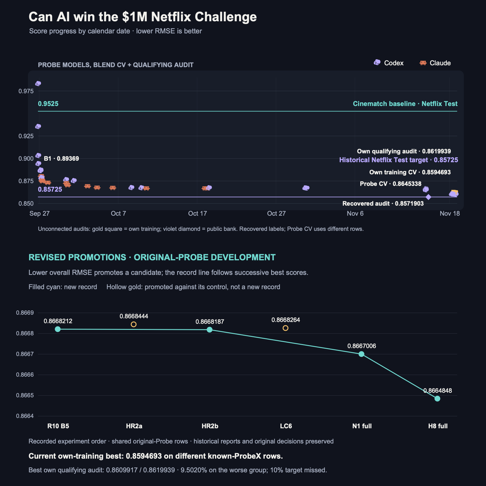

# Netflix Prize reconstruction

Explore the [interactive research journey](https://mquan.github.io/netflix_challenge/)
for the score timeline, recorded training-run curves, strategy decisions, and
attribution evidence. The [standalone HTML](research_journey.html) can be rebuilt
with `python3 scripts/build_research_journey.py`.

This project targets the **original Netflix Prize dataset and split**, not the
later PRML 2019 classroom contest. It implements selected BellKor-style models,
not the complete winning ensemble.

## Progress at a glance

[](https://mquan.github.io/netflix_challenge/)

## The 10% target reached

Exactly two months after we started, our ensemble beat the Netflix Prize’s 10% improvement target on both sets of recovered contest ratings. The higher of the two error scores was **0.857244 RMSE**, just below the 0.85725 target. We trained the models ourselves on the Netflix ratings. The scores below come from community-recovered ratings evaluated after the competition.

| Recovered ratings | Count | RMSE ↓ |
| --- | ---: | ---: |
| Source 0 | 1,408,789 | 0.85614526 |
| Source 1 | 1,408,342 | 0.85724395 |

### The solution

We started with the Own17x + CF96 ensemble. One addition combined temporal SVD++, a latent factor model that learned viewers’ shared tastes and how they changed over time, with an item–item neighborhood model that learned how much weight to give each viewer’s ratings of related movies. The final gain came from accounting for whether the viewer rated those movies before or after the movie we were predicting. That adjustment took the higher of the two error scores from **0.85725978** to **0.85724395**, just under the target.

[Independent score and prediction verification](experiments/OWN-direction-target-verification-20261127.json) · [Earlier 619-input public-prediction blend](BREAKTHROUGH.md)

## All research milestones

The table includes all 110 milestones behind the interactive timeline, including experiments omitted from the overview chart. Compare scores within the same evaluation. Probe and known ProbeX are development ratings. Recovered qualifying rows report the higher error of the two recovered groups.

| Date (Pacific) | Experiment | Evaluation | RMSE ↓ |
| --- | --- | --- | ---: |
| Sep 27 | C0 — User and movie bias | Single model · Probe | 0.98256528 |
| Sep 27 | C1 — Temporal effects model | Single model · Probe | 0.93491601 |
| Sep 27 | C2 — 32-factor SVD++ | Single model · Probe | 0.90267216 |
| Sep 27 | B1 — First user-fold blend | Blend CV · Probe | 0.89369009 |
| Sep 27 | B4 — Learned item neighbors | Blend CV · Probe | 0.88666465 |
| Sep 27 | B7 — 128-neighbor graph | Blend CV · Probe | 0.88584605 |
| Sep 27 | B6 tree — LightGBM over 15 columns | Blend CV · Probe | 0.88040209 |
| Sep 27 | Union — Two branches, fixed average | Blend CV · Probe | 0.87821996 |
| Sep 27 | R3 — Residual tree correction | Blend CV · Probe | 0.87738608 |
| Sep 27 | R4-C — Wider neighborhood bank | Blend CV · Probe | 0.87545342 |
| Sep 27 | R5-meta — Training-derived context | Blend CV · Probe | 0.87480941 |
| Sep 28 | R6-RBM5-s3 — Six conditional RBM columns | Blend CV · Probe | 0.87311591 |
| Sep 30 | C5 parallel — Local GP compact blend | Parallel blend CV · Probe | 0.87590279 |
| Sep 30 | R7-MH3 — Masked rating history | Blend CV · Probe | 0.87258480 |
| Oct 01 | R7-MT56-s3 — Masked history variants | Blend CV · Probe | 0.87038930 |
| Oct 01 | C12 parallel — Fixed session-context average | Parallel blend CV · Probe | 0.87477805 |
| Oct 03 | R8 Bayes — Bayesian timeSVD++ | Blend CV · Probe | 0.86923190 |
| Oct 04 | R8 NN2 — Neural residual blend | Blend CV · Probe | 0.86765030 |
| Oct 06 | R8 A2e — Longer masked sequence | Blend CV · Probe | 0.86741310 |
| Oct 09 | R8 A2h — 1536-step A2h + NN2 | Blend CV · Probe | 0.86709845 |
| Oct 10 | R9 LAT — K1 latent and bias features | Blend CV · Probe | 0.86687064 |
| Oct 11 | R10 B5 — Bayesian item-frequency screen | Blend CV · Probe | 0.86682120 |
| Oct 18 | HR2a — Honest A2h residual blend | Blend CV · Probe | 0.86684441 |
| Oct 18 | HR2b — Honest Bayesian residual blend | Blend CV · Probe | 0.86681873 |
| Oct 19 | LC6 — Training-trajectory snapshots | Blend CV · Probe | 0.86682644 |
| Oct 31 | N1 full — Choice-token transformer blend | Blend CV · Probe | 0.86670063 |
| Oct 31 | H8 full — Matched headroom-feature blend | Blend CV · Probe | 0.86648484 |
| Nov 18 | REMOTE83 Claude + Codex — Claude remote models + Codex local blend | Blend CV · known ProbeX | 0.86219434 |
| Nov 18 | FRESH86 context — Own trained predictors + context NN | Blend CV · known ProbeX | 0.86006371 |
| Nov 18 | FRESH86 matched — Own trained predictors: matching tree + context NN | Blend CV · known ProbeX | 0.86003006 |
| Nov 18 | FRESH85 qualifying — Our 85-predictor bank: first qualifying audit | Recovered qualifying | 0.86280678 |
| Nov 19 | FRESH91 tree + NN86 — Own trained predictors: tree91 + contextNN86 | Blend CV · known ProbeX | 0.85997456 |
| Nov 19 | FRESH86 qualifying — Own matching86 bank: qualifying audit | Recovered qualifying | 0.86243556 |
| Nov 19 | FRESH91 qualifying — Own tree91 + exact full-fit contextNN86: qualifying audit | Recovered qualifying | 0.86240212 |
| Nov 19 | FRESH91 context — Own tree91 + contextNN91: verified development best | Blend CV · known ProbeX | 0.85995970 |
| Nov 19 | FRESH91 context qualifying — Context91 qualifying audit: preceding best retained | Recovered qualifying | 0.86241666 |
| Nov 19 | FRESH103 context — Own tree91 plus contextNN103: improved fixed combination | Blend CV · known ProbeX | 0.85954003 |
| Nov 19 | FRESH103 NN — Own103 context NN: new verified development best | Blend CV · known ProbeX | 0.85946926 |
| Nov 19 | FRESH103 mean qualifying — Own103 fixed combination improves qualifying audit | Recovered qualifying | 0.86202208 |
| Nov 19 | FRESH103 NN qualifying — Own103 standalone NN: new verified qualifying best | Recovered qualifying | 0.86199386 |
| Nov 19 | FRESH107 RBM50 NN — Own107 plus50 original RBM context: new development best | Blend CV · known ProbeX | 0.85945541 |
| Nov 19 | FRESH107 RBM50 qualifying — Own107 plus50 RBM context: new verified qualifying best | Recovered qualifying | 0.86191418 |
| Nov 19 | FRESH107 RBM50 mean — Expanded tree plus context NN: new verified development best | Blend CV · known ProbeX | 0.85936616 |
| Nov 19 | FRESH107 all90 GPU mean — Expanded tree plus all90 GPU NN: new verified development best | Blend CV · known ProbeX | 0.85927206 |
| Nov 19 | FRESH107 all90 mean qualifying — Expanded tree plus all90 GPU NN: new verified qualifying best | Recovered qualifying | 0.86186055 |
| Nov 19 | FRESH110 GPU mean screen — Whole110 GPU mean: existing best retained | Blend CV · known ProbeX | 0.85929964 |
| Nov 19 | FRESH166 GPU mean screen — Own166 GPU mean: existing best retained | Blend CV · known ProbeX | 0.85928923 |
| Nov 19 | FRESH166 H512 mean screen — Larger512/rank64 GPU model: existing best retained | Blend CV · known ProbeX | 0.85934177 |
| Nov 19 | FRESH109 AutoRec mean screen — Own AutoRec additions: existing best retained | Blend CV · known ProbeX | 0.85927452 |
| Nov 19 | FRESH AutoRec consensus — Own fixed consensus: new verified development best | Blend CV · known ProbeX | 0.85924329 |
| Nov 19 | FRESH107 item154 mean — Own64 item context: new verified development best | Blend CV · known ProbeX | 0.85923098 |
| Nov 19 | FRESH AutoRec consensus qualifying — Own fixed consensus: verified qualifying improvement | Recovered qualifying | 0.86180063 |
| Nov 19 | FRESH107 item154 qualifying — Own64 item context: independently verified qualifying improvement | Recovered qualifying | 0.86173789 |
| Nov 19 | FRESH107 user218 mean screen — Own epoch20 user context: existing best retained | Blend CV · known ProbeX | 0.85944867 |
| Nov 19 | FRESH111 split3 mean screen — Four original split3 additions: existing best retained | Blend CV · known ProbeX | 0.85928380 |
| Nov 19 | FRESH107 item186 mean screen — Rank1000 item context: existing best retained | Blend CV · known ProbeX | 0.85935223 |
| Nov 19 | FRESH107 calibrated qualifying — One known-fit coefficient: new independently verified qualifying best | Recovered qualifying | 0.86166360 |
| Nov 19 | FRESH107 own5 qualifying — Five own families: independently verified qualifying best | Recovered qualifying | 0.86158322 |
| Nov 19 | FRESH107 quadratic audit — Negative quadratic calibration: convex best retained | Recovered qualifying | 0.86159357 |
| Nov 19 | FRESH107 tree154 mean — Full item154 context in both families: new independently verified CV best | Blend CV · known ProbeX | 0.85920129 |
| Nov 19 | FRESH109 itemAE mean screen — Fixed item-autoencoder snapshots: verified negative study | Blend CV · known ProbeX | 0.85931594 |
| Nov 19 | FRESH107 tree154 qualifying — Full tree154 fixed half mean: matched control improves, overall best retained | Recovered qualifying | 0.86171900 |
| Nov 19 | FRESH107 own6 qualifying — Six eligible own families: independently verified qualifying best | Recovered qualifying | 0.86156620 |
| Nov 19 | FRESH109 attention mean screen — Original attention64 pair: verified negative development study | Blend CV · known ProbeX | 0.85927082 |
| Nov 19 | FRESH109 KNN3 mean screen — Both original residual KNN3 chains: verified negative full neural study | Blend CV · known ProbeX | 0.85929314 |
| Nov 19 | FRESH115 split3 eight mean screen — All eight completed split3 additions: verified negative neural study | Blend CV · known ProbeX | 0.85924265 |
| Nov 19 | FRESH109 CF96 prefix20/30 mean screen — Own original CF96 epoch20/30: complete negative neural study | Blend CV · known ProbeX | 0.85925487 |
| Nov 19 | FRESH native NN pool6 — Six fixed native-neural variants improve matched NN; global CV best retained | Blend CV · known ProbeX | 0.85925468 |
| Nov 19 | FRESH native NN pool6 tree31 — Fixed75% native NN pool /25% tree: independently improved development best | Blend CV · known ProbeX | 0.85912679 |
| Nov 19 | NNPOOL6 own7 qualifying — Own7 full audit: essentially tied, six-family benchmark retained | Recovered qualifying | 0.86156589 |
| Nov 19 | NNPOOL6 tree25 qualifying — Fixed tree25/pool75: development gain does not carry to qualifying | Recovered qualifying | 0.86166583 |
| Nov 19 | NNPOOL6 equal qualifying — Equal six-NN full audit: no qualifying promotion | Recovered qualifying | 0.86179663 |
| Nov 20 | FRESH167 context218 tree half — Larger own latent context: complete negative development study | Blend CV · known ProbeX | 0.85947866 |
| Nov 20 | FRESH176 recent10 ridge diagnostic — Ten own predictors add verified linear information; neural study queued | Blend CV · known ProbeX | 0.86227347 |
| Nov 20 | FRESH181 recent15 ridge diagnostic — Fifteen own additions: modest linear gain; no overall promotion | Blend CV · known ProbeX | 0.86222791 |
| Nov 20 | FRESH330 unused149 ridge diagnostic — All149 unused own predictors improve every ridge fold | Blend CV · known ProbeX | 0.86197108 |
| Nov 20 | FRESH176 full neural fixed-half screen — Recent-ten full neural study narrowly misses global best | Blend CV · known ProbeX | 0.85913369 |
| Nov 20 | FRESH_SPLIT3 expanded-known fixed-half diagnostic — Extra known training labels help the matched bank, which remains below best quality | Blend CV · known ProbeX | 0.86222599 |
| Nov 20 | FRESH330 full neural tree154 half — Own330 full neural/tree half becomes the verified development best | Blend CV · known ProbeX | 0.85894750 |
| Nov 20 | FRESH330 own7 qualifying — Own330 seven-family blend improves both recovered groups | Recovered qualifying | 0.86138813 |
| Nov 20 | FRESH330 fixed-half qualifying — Development-selected fixed half trades off recovered groups | Recovered qualifying | 0.86155997 |
| Nov 20 | FRESH352 temporal22 ridge diagnostic — Complete temporal trajectory improves every known ridge fold | Blend CV · known ProbeX | 0.86186111 |
| Nov 20 | FRESH352 full neural tree154 half — Complete temporal addition improves the verified development best | Blend CV · known ProbeX | 0.85891606 |
| Nov 20 | FRESH352 fixed-half qualifying — Declared full own352 fold-bag half misses qualifying benchmark | Recovered qualifying | 0.86160388 |
| Nov 20 | FRESH complete13 ridge10 qualifying — Declared signed ridge control trades off groups against primary | Recovered qualifying | 0.86138399 |
| Nov 20 | FRESH352 own7 qualifying — Complete own352 fold bag adds negligible qualifying improvement | Recovered qualifying | 0.86138527 |
| Nov 20 | FRESH complete13 qualifying — All completed component families add a small verified qualifying gain | Recovered qualifying | 0.86137380 |
| Nov 20 | FRESH complete13 context FWLS qualifying — Context-weighted component stack narrowly misses the constant-weight primary | Recovered qualifying | 0.86139603 |
| Nov 20 | FRESH full404 context FWLS qualifying — Full-bank feature-weighted stacking is a negative result | Recovered qualifying | 0.86234232 |
| Nov 20 | FRESH paired391 ridge diagnostic — Matched paired inputs pass; added scalar ridge gain is tiny | Blend CV · known ProbeX | 0.86185088 |
| Nov 20 | FRESH paired391 H128 tree154 half — Matched391 neural study verifies a negligible development gain | Blend CV · known ProbeX | 0.85891340 |
| Nov 20 | FRESH paired391 H512 control — Wider matched391 control is fully verified and worse | Blend CV · known ProbeX | 0.85904815 |
| Nov 21 | FRESH own14 ridge10 qualifying — Declared own14 signed ridge control trades off recovered groups | Recovered qualifying | 0.86137820 |
| Nov 21 | FRESH matched391 fixed-half qualifying — Matched391 fixed half remains a negative qualifying control | Recovered qualifying | 0.86159573 |
| Nov 21 | FRESH own14 qualifying — Matched391 fold bag adds a small verified qualifying gain | Recovered qualifying | 0.86136815 |
| Nov 21 | FRESH complete trajectories H128 tree154 half — Complete trajectories slightly improve verified development CV | Blend CV · known ProbeX | 0.85886309 |
| Nov 21 | FRESH complete trajectories H128 neural control — Neural-only control improves its matched predecessor | Blend CV · known ProbeX | 0.85900602 |
| Nov 21 | FRESH own15 qualifying — Complete-trajectory fold bag adds a small recovered qualifying gain | Recovered qualifying | 0.86134239 |
| Nov 21 | FRESH own15-ridge10 qualifying — Declared own15 signed ridge remains a control | Recovered qualifying | 0.86135596 |
| Nov 21 | FRESH complete-trajectory-fixed-half qualifying — Declared complete-trajectory half remains a negative control | Recovered qualifying | 0.86157501 |
| Nov 21 | FRESH local RBM16 ridge10 qualifying — Declared local RBM16 ridge remains a control | Recovered qualifying | 0.86135553 |
| Nov 21 | FRESH local RBM16 preceding control — Original own15 primary retained as the fixed control | Recovered qualifying | 0.86134239 |
| Nov 21 | FRESH local RBM16 qualifying — Full RBM400 adds only a tiny independently verified recovered gain | Recovered qualifying | 0.86134209 |
| Nov 22 | FRESH Own17 simplex qualifying — Own17 verifies a small improvement on both recovered groups | Recovered qualifying | 0.86132655 |
| Nov 24 | FRESH Own17x global qualifying — 65 additional own-trained predictors improve the matched global blend | Recovered qualifying | 0.86084907 |
| Nov 24 | FRESH Own17x CF48 qualifying — CF48 residual correction improves Own17x | Recovered qualifying | 0.86072426 |
| Nov 24 | FRESH Own17x CF48 CatBoost qualifying — CatBoost residual correction further improves Own17x | Recovered qualifying | 0.86067024 |
| Nov 24 | FRESH Own17x CF96 context CatBoost qualifying — CF96 residual-neighborhood predictors with context and CatBoost corrections | Recovered qualifying | 0.86059917 |
| Nov 26 | FRESH variance-stable qualifying blend — First own-trained group clears the 10% target | Recovered qualifying | 0.85752135 |
| Nov 27 | FRESH directional neighborhood ensemble — Both recovered groups clear the 10% target | Recovered qualifying | 0.85724395 |

## Development validation

The original development runs use RMSE on the held-out Probe. Local production
refits can include original Probe ratings; those runs are evaluated separately
on qualifying queries. The following commands describe the development setup.

The primary local metric is RMSE on Netflix's labeled probe set. Probe ratings
are physically excluded from the training CSR during ingestion. The unlabeled
qualifying pairs are retained only as implicit-feedback events, matching the
published BellKor definition of `N(u)`.

```sh
make download   # resumable download from the Internet Archive
make verify     # checks Netflix archive MD5
make extract
make ingest
make baseline
build/netflix eval-baseline \
  --data data/processed/netflix.bin \
  --model artifacts/baseline.bin
make time-baseline
build/netflix eval-time-baseline \
  --data data/processed/netflix.bin \
  --model artifacts/time-baseline.bin
# Advanced checkpoints (longer-running)
make svdpp-f32
make svdpp
make time-svdpp
make svdpp-seed42
make blend
```

The published checkpoints to keep in mind are:

- Cinematch: 0.9514 quiz RMSE
- BellKor time-aware baseline: about 0.9278 on its reported competition split
- BellKor timeSVD++ variants: about 0.8762–0.8914 reported quiz RMSE
- winning private test submission: 0.856704 RMSE

Probe, quiz, and private test scores are similar but not interchangeable. We
select models, epochs, and blend weights using development labels. Current
work also audits frozen predictions against community-provided recovered
qualifying labels. Multiple audits have now occurred: these are adaptive local
measurements, not an untouched private test or official Netflix scoring.
Qualifying ratings never train the models or choose their stopping epochs.

## Current implementation

- verified/resumable original-data download
- deterministic parser for all 100,480,507 dated ratings
- exact probe removal and local RMSE evaluation
- implicit-feedback CSR containing train, probe, and qualifying interactions
- regularized user/movie bias baseline
- frequency-aware temporal baseline with item time bins, user drift,
  per-user-day effects, and time-varying rating-scale effects
- SVD++ residual factorization with train/probe/qualifying interactions used as
  unlabeled implicit feedback

Local development checkpoints (probe labels excluded from model gradients,
but used for epoch selection):

- static regularized baseline: `0.98256528`
- 40-epoch temporal baseline: `0.93506871` (best observed epoch: `0.93491601`)
- 32-factor SVD++: `0.90267216` (best observed epoch: 7)
- 64-factor SVD++: `0.90079729` (best observed epoch: 7)
- 64-factor post-hoc temporal drift: `0.90055257` (best observed epoch: 5)
- 32/64-factor blend: `0.90019305`
- three-model SVD++/timeSVD++ blend: `0.89970985`

- jointly trained temporal SVD++, 128 factors: `0.89617220`
- seven-model contextual ridge ensemble: `0.89013424` development CV
- add learned item-neighborhood predictions: `0.88666465` development CV
- add quadratic blend calibration: **`0.88658149` development CV**
- add 256-factor checkpoint: **`0.88632074` development CV**
- add frozen 128-neighbor checkpoint: **`0.88584605` development CV**
- residual item kNN on every joint model, conditional RBM, denoising
  autoencoder, and a LightGBM blender with meta-features:
  `0.88040209` development CV (see `RESULTS.md`)
- cross-branch predictor bank and residual-tree blend: `0.87545342` development CV
- seven more user/movie context features: **`0.87480941` development CV**

The R5 input bank for that historical best is absent from this checkout. The
lowest currently reproducible local development result is C12 at
**`0.87477805` RMSE**, a fixed equal average of two compact ensembles using
the C1 bank plus
a conditioned RBM, a frozen DeepRecommender snapshot, and a local GP predictor
with support features, one unique kNN graph-support feature and same-day
training context. See
[GP_COMPACT.md](GP_COMPACT.md), [RBM_CONTEXT.md](RBM_CONTEXT.md) and
[SESSION_META.md](SESSION_META.md) for
the matched comparison and limitations.

The older `time-svdpp` command freezes its static model before fitting drift;
it is not a jointly optimized timeSVD++ implementation. The new `joint` command
jointly trains temporal biases, user/item factors, implicit feedback and user
factor drift. Optional per-user-day factors model short-lived preferences.

`scripts/gbdt_blend.py` needs `numpy` and `lightgbm`; `scripts/autorec.py`
needs `numpy` and `torch` (MPS is used when available). Install them in a
virtualenv; the C++ tool has no extra dependencies.
On this macOS setup, LightGBM also needs Homebrew `libomp` (`brew install libomp`).

## Joint training and reproducible experiments

```sh
make test
python3 scripts/experiment.py --name my-joint128 \
  --strategy 'Joint temporal and implicit model, 128 factors, regularization .02' -- \
  build/netflix joint --data data/processed/netflix.bin \
    --model artifacts/my-joint128.bin --factors 128 --iterations 40 \
    --regularization .02 --decay .95 --patience 6 \
    --predictions artifacts/my-joint128.f32
build/netflix eval-joint --data data/processed/netflix.bin \
  --model artifacts/my-joint128.bin --predictions artifacts/reloaded.f32
```

Experiment names must be new. Each run records its strategy, exact command,
source/binary hashes, input hashes, epoch log and output hashes in `experiments/`.
New runs also retain an actual `.source.zip` snapshot of source, runner, tests
and build recipe, so uncommitted implementations remain recoverable. Earlier
hash-only runs cannot be reconstructed from hashes alone. Major milestones
have Git tags, starting with `milestone-probe-cv-0.886665`.
Artifacts and original data remain local and untracked. Logs measure wall time,
which can include computer sleep. Models retain the best probe epoch.
`--init-model` is a warm start: it resets the learning-rate schedule, random
generator and epoch counter, so it is not an exact interrupted-run resume.
`--day-factors 128` adds about 9 GB of parameters on the original data; leave it
at zero for lower memory use.
`--frequency-factors 1` adds movie factors specific to the user's daily rating
frequency bin, as in equation 16 of the
[BellKor report](https://www.asc.ohio-state.edu/statistics/dmsl/GrandPrize2009_BPC_BellKor.pdf).
It uses `--frequency-rate .00002` and `--frequency-regularization .02` by default
and adds about 73 MB at rank 128. This component is experimental; a matched
continuation control tests its benefit. Version-3 joint checkpoints retain it,
and older version-1/2 checkpoints remain readable.

Raw prediction files are float32 columns in processed probe order. Only blend
columns from this exact dataset and row order; do not read a column while its
trainer is updating it. For example, with the recorded completed artifacts:

```sh
build/netflix ensemble --data data/processed/netflix.bin \
  --prediction artifacts/legacy.a.f32 --prediction artifacts/legacy.b.f32 \
  --prediction artifacts/legacy.c.f32 --prediction artifacts/joint64.f32 \
  --prediction artifacts/joint128-reg005.f32 \
  --prediction artifacts/joint128-reg02.f32 \
  --prediction artifacts/joint128-day128.f32 \
  --contexts 1 --predictions artifacts/recheck-b3.f32 \
  --weights artifacts/recheck-b3.weights
```

`blend_cv_rmse` fits ridge weights on four user folds and scores the fifth,
repeated for all five folds. `blend_fit_rmse` fits and scores on all probe rows.
The output column holds cross-fitted predictions; its `.fit` companion holds
full-fit predictions. Contexts let weights vary with training-history size,
movie popularity, date and same-day activity. These features contain no probe
rating values. **CV is still a development estimate:** base-model checkpoint
selection uses the whole probe. It is not an untouched final-test evaluation.

Optional `--quadratic 1` adds pairwise products of centered predictions to the
ridge blend. This captures nonlinear calibration and agreement patterns while
fitting all coefficients separately in each user fold. Weight exports include
these interaction coefficients. It costs more than the linear blend.

## Structurally different model: learned neighborhoods

```sh
build/netflix graph --data data/processed/netflix.bin \
  --graph artifacts/neighbors64.bin --neighbors 64 --history-cap 256
build/netflix neighborhood --data data/processed/netflix.bin \
  --graph artifacts/neighbors64.bin --time-model artifacts/time-baseline.bin \
  --model artifacts/neighborhood64.bin --predictions artifacts/neighborhood64.f32 \
  --iterations 12
build/netflix eval-neighborhood --data data/processed/netflix.bin \
  --graph artifacts/neighbors64.bin --time-model artifacts/time-baseline.bin \
  --model artifacts/neighborhood64.bin --predictions artifacts/neighborhood-reloaded.f32
```

This is an approximation to the learned neighborhood family, not a full
reproduction of BellKor's integrated model. Graph discovery uses training-only
bias-adjusted residual cosine with histories capped for compute. Explicit and
implicit neighbor weights are then learned on all training ratings against a
frozen temporal baseline. The graph, dataset and original temporal baseline
must accompany the neighborhood checkpoint when evaluating it.
Its success criterion is improvement when added to the existing ensemble,
not necessarily a better standalone score.
Optional `--time-decay 0.002` multiplies explicit and implicit neighbor inputs
by `exp(-0.002 * absolute_day_gap)`. This is a temporal-locality experiment;
the default zero preserves static neighborhoods. Saved checkpoints retain this
setting and old static neighborhood checkpoints remain readable.

See [RESULTS.md](RESULTS.md) for the experiment-by-experiment score log,
strategy summaries, and next-step decisions.

The current reproduction plan, including the missing R5 artifact audit and the
published-method continuation gate, is in [STRATEGY_RESET.md](STRATEGY_RESET.md).

See [ENRICHMENT.md](ENRICHMENT.md) for the dataset enrichment literature review,
local metadata/support audit, and proposed controlled experiments. This research
has not yet produced an enriched-model RMSE result.

The completed neural-history, sparse-user and session-context pilots are
described in [HISTORY_EXPERIMENTS.md](HISTORY_EXPERIMENTS.md). The date-local
variant was strongest among these three under the frozen B7 control. The final
queue state is stored in `experiments/history-queue-status.json`.

For score over time, run `python3 scripts/score_timeline.py` and plot
[`experiments/score_timeline.csv`](experiments/score_timeline.csv).
Historical timestamps have explicit provenance/uncertainty; new experiment
runs timestamp every output line. The CSV also supports elapsed time minus
recorded idle/rate-limit/timeout intervals, without assuming unknown gaps are
idle. See [timing and activity accounting](experiments/TIMING.md).

## Binary attribute representation (BAR)

The experimental `bar` command implements dense divide-and-concur RRR for
binary user attributes, followed by movie regression. It learns every
parameter from training ratings and selects its checkpoint by training error.
The full Probe is used only for final scoring. See
[the paper review and experiment results](PAPER_IMPLEMENTATIONS.md) for the
paper/source differences and why training RMSE cannot be compared with the
Netflix winning test score.

```sh
build/netflix bar --data data/processed/netflix.bin \
  --model artifacts/bar.bin --predictions artifacts/bar.f32 \
  --attributes 8 --movies 59 --iterations 1000 --threads 4 \
  --eval-every 50 --projection upstream
build/netflix eval-bar --data data/processed/netflix.bin \
  --model artifacts/bar.bin --predictions artifacts/bar-reloaded.f32
```

`--projection paper` uses the stated interval projection; `upstream` matches
the authors' projection-to-center behavior inside that interval. Replicas use
float32, and movie regression uses ridge 0.001. The default replica allocation
limit is 8 GiB (`--max-replica-gib`); the configuration above uses 3.38 GiB for
replicas, plus the dataset and other arrays. Predictions use the usual Probe
row order and remain unclipped until scoring.

## Independent local-kernel experiments

The `moonshot-local-kernels` branch adds a separate research binary using local
Gaussian-process residual inference over a frozen joint model. A six-component
frozen ensemble improves from `0.8860971552` to `0.8850493143` development CV
with the first GP family, then to `0.8842984317` with one GP combining persistent
and 30-day taste effects. Adding two residual-factor controls reaches
`0.8841835475`, with only a small additional gain. These are controlled comparisons within this branch;
the control differs from the historical B4 ensemble above.

`make test-moonshot-gp` builds the macOS Accelerate implementation and runs its
numeric and probe-label isolation tests. `make moonshot-local` builds a separate
experimental mixture of local residual factorizations. See
[MOONSHOTS.md](MOONSHOTS.md) for the research and first round, and
[ROUND2.md](ROUND2.md) for the additional bets, ablations, commands and limitations.
Predictions and copied input checkpoints remain local under `artifacts/`.

The next round tests predictor diversity and nonlinear blending separately.
The same 12-column bank reaches `0.8835714199` with a shallow neural correction.
Adding the other agent's completed RBM gives `0.8811258732` with contextual
ridge and **`0.8803262843` with neural blending**, improving all five user folds.
Epoch selection is nested inside each outer fold; base checkpoint selection
still makes these development CV estimates. See [NEURAL_BLEND.md](NEURAL_BLEND.md)
for the Netflix research, controlled comparisons, attribution and reproduction
requirements.

A fixed 50/50 average of this neural ensemble and the other branch's B6
LightGBM ensemble reaches **`0.8786685218` development CV**, beating both in every
user fold. See [COMBINED_BRANCHES.md](COMBINED_BRANCHES.md) for the comparison,
verified snapshot provenance, and experiments combining the raw predictor banks.
Combining the raw banks reaches `0.8788478728` with neural blending; averaging
that result equally with B6 reaches **`0.8782199562`**, again improving every fold.

The next retained bet is a boosted-tree correction to contextual ridge over the
same frozen union bank. Selecting tree count on inner users and refitting on all
outer training users reaches **`0.8774504869` development CV**, improving all five
folds over 0.87822. A predeclared equal average of the neural, direct-tree and
residual-tree outputs reaches **`0.8773860815`**. [ROUND3.md](ROUND3.md) records
the controls, weak user-kernel/distributional bets, and remaining research ideas.

Combining the two branches' raw predictors and stronger temporal/kNN columns
reaches **`0.8754534170` development CV** with the residual tree. Seven more
user/movie context features bring the latest result to **`0.8748094089`**,
improving all five user folds. See [ROUND4.md](ROUND4.md) and
[ROUND5.md](ROUND5.md). A separate training-only validation pilot is documented
in [HOLDOUT.md](HOLDOUT.md).

Round 6 adds multithreaded joint training and conditional RBM output biases;
six conditional RBM columns (two seeds and three hidden sizes) move the blend to
**`0.8731159148` development CV** (three LightGBM seeds; 0.8731934913 with one seed).
[ROUND6.md](ROUND6.md) states the 10%-over-Cinematch target, the full
three-stage algorithm, and the evidence for where the remaining gap must come from.

[PLAN_TO_TARGET.md](PLAN_TO_TARGET.md) is the plan for the 10% target
(0.85725 test RMSE). Its Phase 0 dress rehearsal of the final train+probe
submission ([PHASE0_REHEARSAL.md](PHASE0_REHEARSAL.md)) measured test ≈ dev CV
− 0.0074, so the development-CV target is **≈0.8646**.
